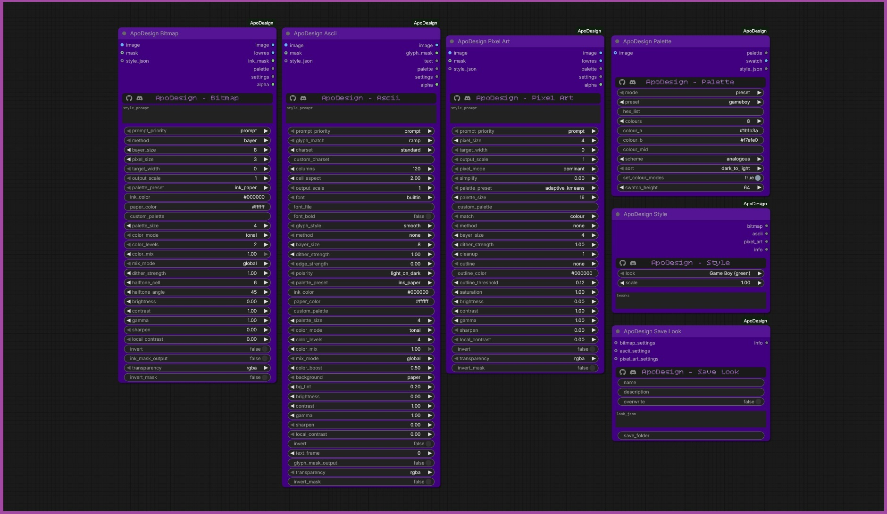

<h1 align="center">ApoDesign</h1>
<p align="center"><b>Retro graphic styles for ComfyUI: dithered bitmap art, ASCII text art and pixel art from images and video.</b></p>
<p align="center">
  <a href="https://github.com/comfyanonymous/ComfyUI"></a>
  <a href="https://github.com/ApoloniArt/ApoDesign/releases"></a>
  <a href="https://github.com/ApoloniArt/ApoDesign/blob/main/LICENSE"></a>
  <a href="https://github.com/ApoloniArt/ApoDesign/blob/main/requirements.txt"></a>
  <a href="https://github.com/ApoloniArt/ApoDesign/commits"></a>
  <a href="https://github.com/ApoloniArt/ApoDesign/commits"></a>
  <a href="https://github.com/ApoloniArt/ApoDesign/stargazers"></a>
  <a href="https://discord.gg/XDExAUzuZp"></a>
  <a href="https://github.com/ApoloniArt"></a>
</p>


<h3 align="center">All render nodes share one colour engine, so they behave the same way, and a single look works in all three.</h3>

## Nodes

| Node | What it does |
|---|---|
| **ApoDesign Bitmap** | Dither and halftone art: Mac Plus, Game Boy, newspaper and engraving looks. 12 dither methods, any palette. |
| **ApoDesign Ascii** | Text art drawn as an image *and* returned as plain text. Ramp, shape-matching and braille modes, custom fonts. |
| **ApoDesign Pixel Art** | Flat colour, crisp edges, small palette, selective outlines, painterly simplify. |
| **ApoDesign Style** | The easy way in: pick one of 47 built-in looks (or your own) and connect it to any render node. |
| **ApoDesign Palette** | Build a palette from a preset, hex codes, an image, a gradient or a colour scheme. |
| **ApoDesign Save Look** | Save the settings you tuned as your own look, so it appears in the Style list. |

Also: PNG transparency and masks in every render node, video and batch support that stays steady between frames and light on memory, and a plain-English `style_prompt` or JSON `style_json` input on every render node.

## Installation

1. <h3 align="left">Comfy Manager Install [recommended]:</h3>
   
   ApoDesign has no extra requirements (torch, numpy and Pillow already ship with ComfyUI), so you can install it via Comfy Manager without any fear of breaking your Comfy. Search **APO** in Manager. After installation, rename the folder to **ComfyUI-ApoDesign**.

2. <h3 align="left">Manual Install [git clone]:</h3>
   ```
   cd ComfyUI/custom_nodes
   git clone https://github.com/ApoloniArt/ApoDesign ComfyUI-ApoDesign
   ```
   No Git? On GitHub press *Code > Download ZIP*, unpack it, and put the folder into `ComfyUI/custom_nodes/` named `ComfyUI-ApoDesign`.

3. Restart ComfyUI fully (close the console window too). The nodes appear under **ApoDesign** in the Add Node menu.

**Update:** in Comfy Manager press *Update*, or for a manual install run `git pull` inside `custom_nodes/ComfyUI-ApoDesign`, then restart. Your own looks and `looks_folder.txt` are not part of the repository, so an update never touches them (see [Style, Save Look and your own looks](docs/style-and-looks.md)).

## Quick start

1. Add **Load Image**, **ApoDesign Style** and **ApoDesign Pixel Art**.
2. Connect the image to Pixel Art's `image`, and Style's `pixel_art` output to Pixel Art's `style_json`.
3. Pick a look in Style (try *Game Boy (green)*), add **Preview Image**, run.
4. Switch the look and run again. Connect Style's `bitmap` or `ascii` output to the other nodes to get the same look in those.

Prefer words? Type `gameboy palette, atkinson dither, 96 wide, high contrast` into any render node's `style_prompt`. The node's `settings` output shows exactly what it understood.

## Your own looks

Tune a node, connect its `settings` output to **ApoDesign Save Look**, name it, run, press **R**: your look is now in the Style list, marked with a star. You can also have an LLM write looks for you (a ready-made system prompt is in `looks/_LLM_system_prompt.txt`) or write them by hand. Folders become menus. Full guide: [docs/style-and-looks.md](docs/style-and-looks.md).

## The banner

Every node has a slim banner with GitHub and Discord icons and the node name in Bitcount Ink. It is cosmetic only. See [docs/banner.md](docs/banner.md).

## Documentation

See the [docs](docs/README.md) folder: a page per node, the Style / Save Look guide, all 47 built-in looks, Palette, Transparency, Video and memory, a generated reference of every widget, and Testing.

## Check your install

Double-click `RUN_TESTS.bat` in the `ComfyUI-ApoDesign` folder. It prints one PASS / FAIL line per test (details in [docs/testing.md](docs/testing.md)).

## Changelog

See [CHANGELOG.md](CHANGELOG.md).

## Credits and licences

ApoDesign is MIT licensed (see `LICENSE`). If you use it in a project, a mention of "ApoDesign by ApoloniArt" is appreciated (see `NOTICE`).

Bundled fonts: **DejaVu Sans Mono** (Bitstream Vera licence, `fonts/LICENSE_DEJAVU.txt`) for the Ascii node, and **Bitcount Ink** (SIL Open Font License 1.1, `web/fonts/OFL.txt`) for the node banner.
