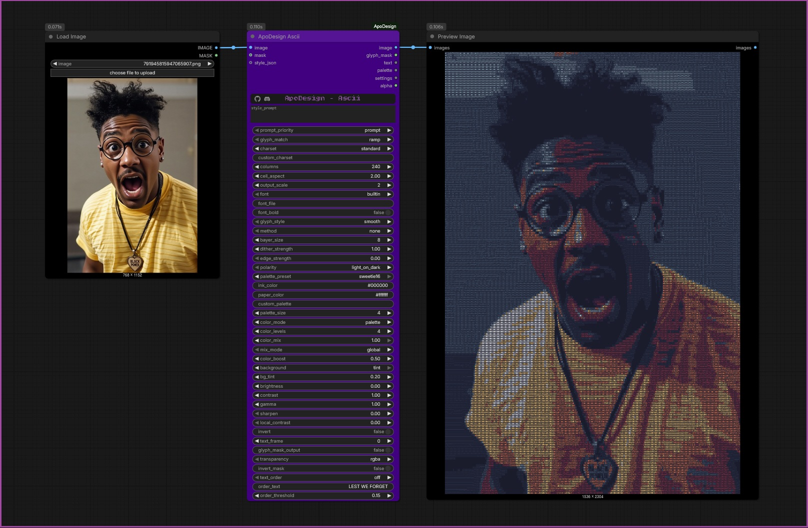
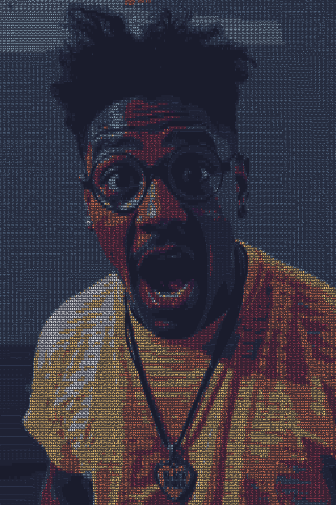

# ApoDesign Ascii

Turns any image (or batch / video frames) into text art, drawn as an image, and also hands you the art as plain text.

## How characters are chosen (`glyph_match`)
| Mode | What it does |
|---|---|
| `ramp` | Classic ASCII. Brightness picks the character. The node measures how much ink every character really has in the chosen font and sorts them, so the tones are accurate for any charset or font. |
| `shape` | Each cell gets the character whose *shape* best matches the picture under it, so edges and curves follow the drawing. Best with `standard` or `quadrants`. |
| `braille` | 2x4 dots per cell: the finest detail text art can have. Needs no font. |

## Characters and size
| Widget | What it does |
|---|---|
| `charset` | `classic` (10), `standard` (70), `simple`, `blocks` (shade blocks), `quadrants` (the 16 half/quarter blocks, a mosaic look), `binary`, `letters`, or `custom` + `custom_charset` |
| `columns` | Characters across. More = finer. The cell size is rounded to whole pixels, so the real count can differ by a few |
| `cell_aspect` | Cell height / width (2.0 suits most monospace fonts) |
| `output_scale` | 1-4. Characters are redrawn at the larger size from the font, so they stay sharp |
| `font`, `font_file`, `font_bold` | `builtin` is DejaVu Sans Mono (bundled). Consolas, Courier New and Lucida Console are used when installed. `custom_file` + a path to any monospace .ttf/.otf. Falls back to builtin, never errors |
| `glyph_style` | `smooth` (anti-aliased) or `crisp` (hard-edged, bitmap-font look) |
| `edge_strength` | Ramp mode: draws `\| / - \\` along strong edges so outlines read as line work |
| `method`, `bayer_size`, `dither_strength` | Dithers the character choice: `none` is clean classic ASCII, `bayer` / `blue_noise` are steady on video, error diffusion is organic but shimmers slightly |

## Colour: black & white, colour, or any mix
`polarity` chooses `light_on_dark` (terminal look) or `dark_on_light` (ink on paper). The darkest and lightest colours of the palette become page and ink; with `ink_paper` those are your `ink_color` and `paper_color`.

`color_mode` (`tonal` / `palette` / `channels`), `color_mix` and `mix_mode` work exactly as in Bitmap, so you can have B&W characters with colour only in the highlights, only on edges, or only where a MASK says. `color_boost` brightens coloured characters on a dark page (the character's density already carries the brightness). `background = tint` lets the page take a faint shade of each cell's colour.

## Prompting
Same as Bitmap, plus text-art words: `braille, 160 columns, green phosphor`, `quadrant mosaic`, `dense characters, edges, bold`, `dark purple on mint`, `colour ascii`, `matrix`. The `settings` output shows what was applied.

## Outputs
`image`, `glyph_mask` (off by default, black and free: turn on `glyph_mask_output` to fill it), `text` (the art as text, ready to copy to a post; `text_frame` picks the frame, -1 = all frames), `palette`, `settings`, `alpha` (see Transparency).

## Video
`ramp` and `braille` with `none`, `bayer` or `blue_noise` are fully steady between frames. `shape` is steady for steady footage. Error diffusion shimmers slightly. Frames go through in small chunks, and the output is written straight into one pre-allocated tensor.

---

## Embedded example image

