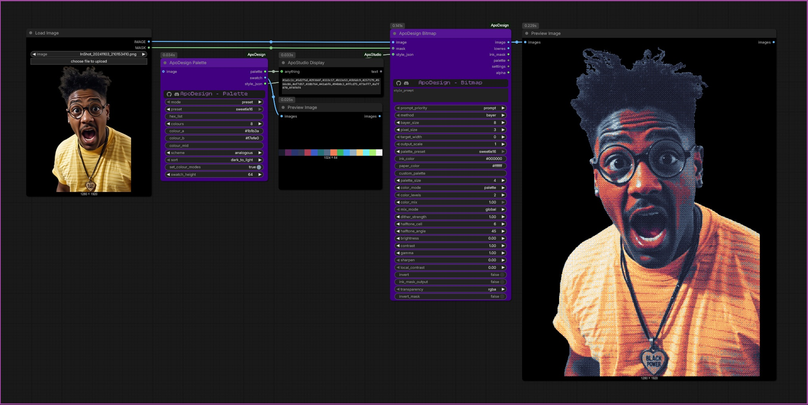

# ApoDesign Palette

Makes a palette and a swatch picture of it. `palette` is the hex list (paste it into any `custom_palette` widget); `style_json` sets `custom_palette` (plus `color_mode` and, for Pixel Art, `match`, to suit the palette) when connected to a render node.

| mode | What it does |
|---|---|
| `preset` | Any classic palette (Game Boy, NES, C64, ZX Spectrum, Apple II, MSX, Amstrad CPC, CGA, EGA, PICO-8, Teletext, Sweetie 16, ...) |
| `hex_list` | Your own colours, e.g. `#0f380f,#306230,#8bac0f` |
| `from_image` | The main colours of the connected image (shared across up to 16 frames of a video) |
| `gradient` | `colour_a` to `colour_b` in `colours` steps, optionally through `colour_mid` |
| `harmony` | A dark-to-light ramp around `colour_a` using a scheme: monochrome, analogous, complementary, split_complementary, triadic, tetradic |
