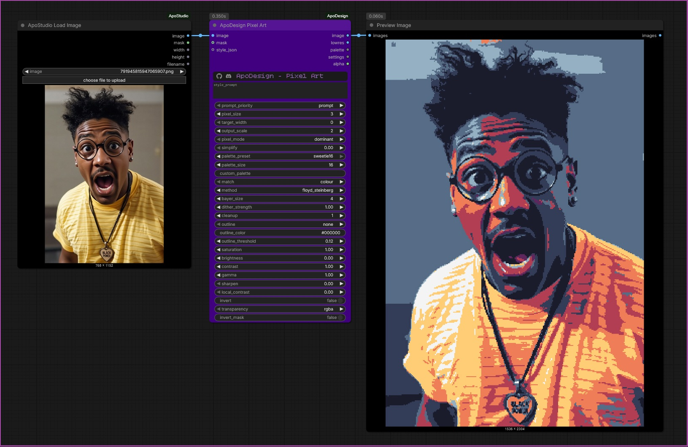
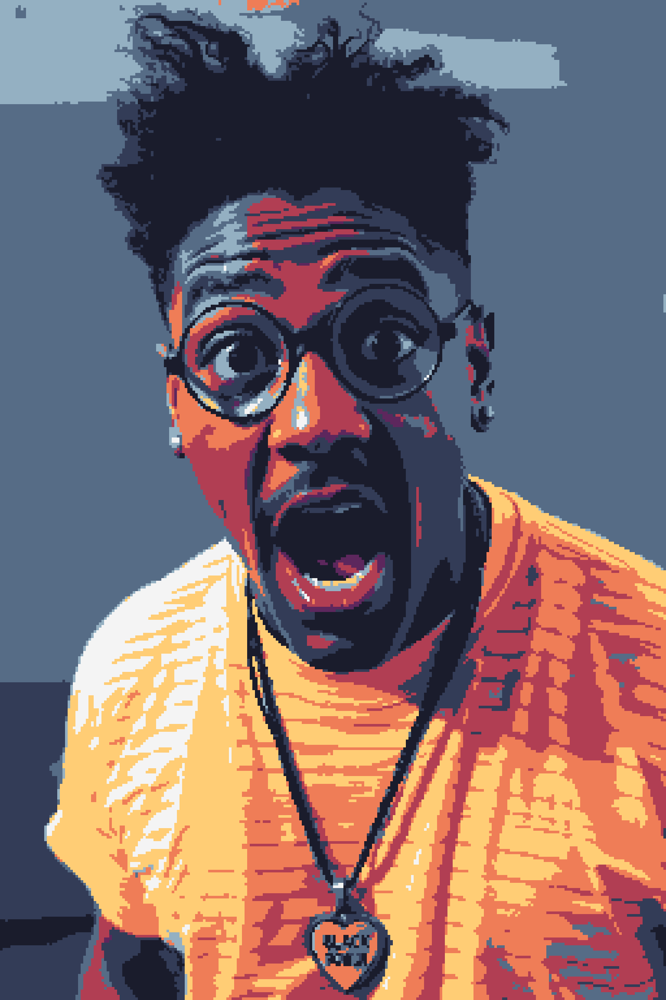

# ApoDesign Pixel Art

Turns any image (or batch / video frames) into clean, hand-made-looking pixel art. Where Bitmap is about dithering and halftone, Pixel Art is about flat colour, crisp edges and a small palette.

## The pixels
| Widget | What it does |
|---|---|
| `pixel_size` / `target_width` | Size of each pixel in source pixels, or the number of pixels across (allows non-integer scaling, e.g. 160 across 1920) |
| `output_scale` | Extra whole-number crisp enlargement |
| `pixel_mode` | `dominant` (default): each pixel takes the most common palette colour in its block, so edges stay crisp like hand-placed pixels. `average`: the block's mean colour (softer, can be muddy). `nearest`: one centre sample |
| `simplify` | Painterly flattening (Kuwahara filter) before pixelating: texture and noise melt into clean colour regions, edges stay sharp. 0 = off |

## Palette
| Widget | What it does |
|---|---|
| `palette_preset` | `adaptive_kmeans` (default: a palette built from your image, shared by every frame of a video), `none` (full colours), or Game Boy, PICO-8, C64, EGA, CGA, and the other classic palettes |
| `palette_size` | Number of colours for `adaptive_kmeans` (2-64) |
| `custom_palette` | Paste hex codes: `#0f380f,#306230,#8bac0f`. Overrides the preset |
| `match` | `colour` (nearest colour, for full-colour palettes) or `tone` (by brightness, for one-hue palettes such as Game Boy, phosphor or sepia) |
| `method`, `bayer_size`, `dither_strength` | Optional dithering when snapping to the palette (used by `average` and `nearest`). `none` is clean |

## Finishing
| Widget | What it does |
|---|---|
| `cleanup` | Removes stray single pixels (1), then progressively more (2, 3). Leave at 0 when using dithering |
| `outline` | `dark`: a darker shade of the pixel's own colour along edges (selective outline). `colour`: your `outline_color`. Drawn on the darker side of an edge |
| `outline_threshold` | How big a brightness step gets an outline. Lower = more lines |
| `saturation`, `brightness`, `contrast`, `gamma`, `sharpen`, `local_contrast`, `invert` | Tone shaping before palette matching |

## Prompting
Same as the other nodes, plus pixel-art words: `24 colours, outline, 160 wide, painterly`, `gameboy, clean`, `vibrant, no dither`.

## Outputs
`image`, `lowres` (the true 1:1 pixel grid), `palette` (hex string), `settings` (JSON of everything used), `alpha` (see Transparency).

## Video
Nothing is random, the palette is shared by all frames (built from up to 16 evenly spaced frames), and dominant / ordered methods are steady between frames. Error diffusion shimmers slightly.

---

## Embedded example image

