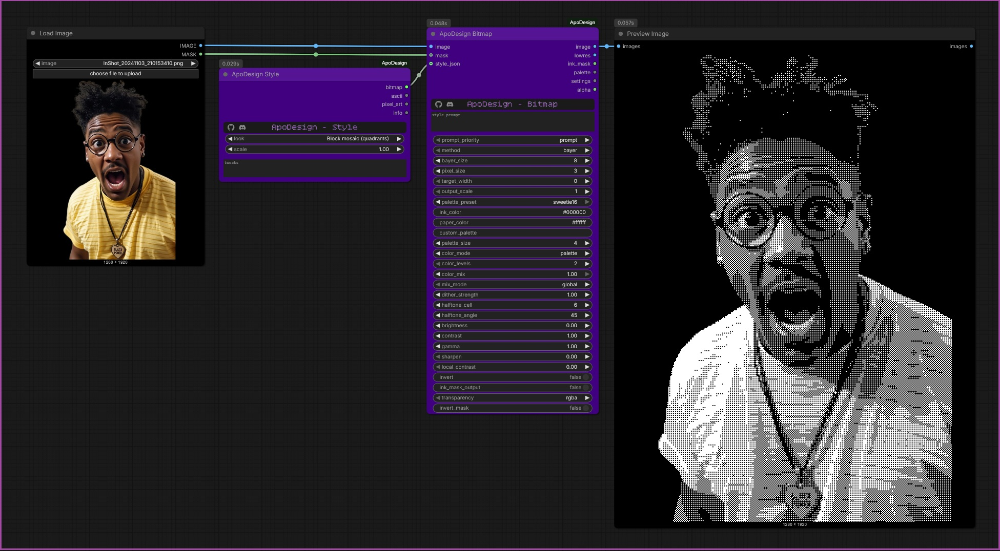

# Style node, Save Look and your own looks

## ApoDesign Style


The easy way in. Pick a **look**, connect the matching output to the `style_json` input of a render node, and that node is set up for you. You do not need to know what any widget does.

1. Add *ApoDesign Style* and choose a `look`.
2. Connect `bitmap` to ApoDesign Bitmap, `ascii` to ApoDesign Ascii, or `pixel_art` to ApoDesign Pixel Art (each one's `style_json` input). The same look gives a matching result in all three nodes.
3. `scale` makes the look chunkier (above 1) or finer (below 1): bigger pixels, fewer characters, larger halftone dots.
4. `tweaks` (optional) changes anything on top of the look, as JSON using the widget names, e.g. `{"palette_size": 8, "outline": "dark"}`. Names a node does not have are skipped for that node. The `info` output lists what was applied.

`style_json` always wins over the widgets of the node it is connected to, so to adjust something use `tweaks`, or disconnect `style_json`. Your own brightness, contrast, gamma, sharpen, local contrast, invert, saturation, output_scale and font choices are left alone unless the look sets them.

The 47 built-in looks are listed in [built-in-looks.md](built-in-looks.md).

## Your own looks

Any look you make appears at the end of the Style node's list, marked with a star, and works with all three render nodes. Press **R** in ComfyUI to refresh the list (no restart needed).

Three ways to make one:

1. **Save from ComfyUI.** Tune a Bitmap, Ascii or Pixel Art node, connect its `settings` output to **ApoDesign Save Look**, give it a name and run it.
2. **Let an LLM write it.** Use `looks/_LLM_system_prompt.txt` as the LLM's system prompt, describe the look in plain words, and paste the reply into Save Look's `look_json` box (or save the reply as a `.json` file in your looks folder).
3. **Write one by hand.** Copy a file from `looks/_examples/` and edit it.

### ApoDesign Save Look

| Input | What it does |
|---|---|
| `name` | Name of the look as shown in the Style node. Empty = use the name inside `look_json`. |
| `description` | Optional one-line description. |
| `overwrite` | Replace an existing look file with the same name. |
| `bitmap_settings`, `ascii_settings`, `pixel_art_settings` | Connect the `settings` output of the node(s) you tuned. |
| `look_json` | A whole look as JSON (for example from an LLM), or just widget names and values. The settings inputs are added on top of it. |
| `save_folder` | Where to save. Empty = your looks folder. A full path (e.g. `D:\ComfyUI\MyLooks`) is created if missing and remembered in `looks_folder.txt`. A bare name (e.g. `Arcade`) makes a sub-folder of the looks folder. |

The `info` output says exactly what was saved, where, and what the look will be called in the Style list.

Save Look saves only the settings that differ from the node defaults, so look files stay small. If every setting on the node is still at its default, it saves all of them (and tells you so), so you can start from there.

### Look files

A look file is a `.json` file:

```json
{
  "name": "Neon arcade",
  "description": "Bright 16-colour arcade look with clean, steady dithering.",
  "extends": "Game Boy (green)",
  "all":       { "palette_preset": "pico8" },
  "bitmap":    { "method": "bayer", "target_width": 200 },
  "ascii":     { "columns": 110 },
  "pixel_art": { "target_width": 200, "outline": "dark" }
}
```

- `extends` starts from another look (built-in or yours).
- `all` sets widgets for every node that has them; `bitmap`, `ascii` and `pixel_art` set widgets for one node.
- One file may hold several looks: `{"looks": [ {...}, {...} ]}`.
- A look with a mistake still loads. The mistake is skipped and reported in the Style node's `info` output.
- Files and folders starting with `_` or `.` are ignored (that is why `_examples` does not show in the list).

### Folders and menus

- Every folder listed in `looks_folder.txt` becomes a menu named after it in the Style list, and its sub-folders become sub-menus: a look in `D:\MyLooks\Arcade` shows as `★ MyLooks > Arcade > Look name`.
- Inside the built-in `looks` folder, its sub-folders are the menus.
- The first folder in `looks_folder.txt` is where Save Look saves by default.
- You can also point ApoDesign at folders with the environment variable `APODESIGN_LOOKS` (folders separated like a PATH).

### Keeping your looks safe when you update

`looks_folder.txt` and any looks you save into the `looks` folder are not part of the repository (they are in `.gitignore`), so `git pull` leaves them alone. If you update by downloading a zip instead, replacing the folder would remove them, so keep your looks in a folder **outside** `ComfyUI-ApoDesign` and put its full path in `looks_folder.txt` (or type it into Save Look's `save_folder` once). The file `looks_folder.txt` does not exist until then; `looks_folder.example.txt` shows the format.

## Palette

See [palette.md](palette.md).
