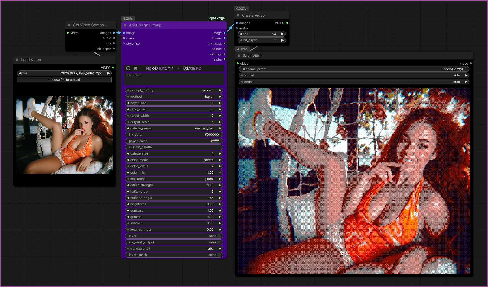

# Video, batches and memory
ComfyUI keeps every node's output in RAM until you clear it, and a clip is one tensor per stage, so a 5 s 1080p clip is several GB at each step. ApoDesign avoids adding to that: input is converted a few frames at a time, outputs are written straight into pre-allocated tensors (no list-then-join copy), the full-size mask is skipped unless asked for, and cached GPU memory is handed back after a batch. The picture itself is computed exactly as before.

Tips: do not send a whole clip into a Preview Image node (it draws every frame); use Save Video, or preview a single frame. After a long clip, ComfyUI's *Unload Models / Free model and node cache* buttons clear what it is holding.
